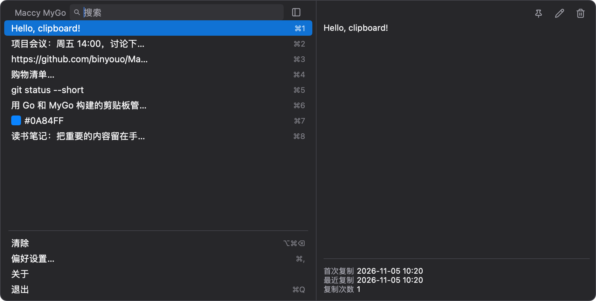

# Maccy-MyGo

基于 [MyGo](https://github.com/egoist/mygo)，使用 Go 重写的 [Maccy](https://github.com/p0deje/Maccy) 剪贴板管理器——轻量、原生、开源。



## 功能

- 菜单栏常驻，`⌘⇧C` 全局呼出（快捷键可自定义）
- 记录文本 / 图片 / 文件 / 富文本；置顶项可绑定快捷键与拖拽排序
- 精确 / 正则 / 模糊 / 混合四种搜索，匹配分段高亮
- 条目编辑与别名、OCR 识别文本、可拖宽的预览侧栏
- 按应用 / 剪贴板类型 / 正则忽略复制，敏感内容不记录
- 深浅色外观、多屏定位、登录启动、自动更新、四种菜单栏图标
- 与原版行为逐项对齐并附验证边界，见 [AUDIT.md](AUDIT.md)

## 使用

| 快捷键 | 作用 |
| --- | --- |
| `⌘⇧C` | 呼出 / 隐藏历史窗口（长按修饰键可循环选择） |
| `⌥P` / `⌥⌫` | 置顶选中项 / 删除选中项 |
| `⌃Space` | 展开预览侧栏 |
| `⌘,` | 偏好设置 |
| `⌥` 点按条目 | 直接粘贴到前台应用；`⌥⇧` 为去格式粘贴 |
| `⌥` 点菜单栏图标 | 暂停 / 恢复记录 |

## 性能

与原版 Maccy 2.7.1（Swift）同机对比（macOS arm64，2026-11-05，本版为当前源码构建）：

| 指标 | 原版 | 本版 |
| --- | --- | --- |
| 空闲内存 (phys_footprint) | ~223 MB | ~30 MB |
| 启动至空闲 | ~1.0 s | ~0.5 s |
| 搜索 200 条（exact / fuzzy） | 6.7 / 3.5 ms | 0.4 / 1.1 ms |
| 剪贴板捕获延迟 | ~280 ms | ~264 ms（同为 0.5s 轮询） |
| 应用体积 | 10 MB | 15 MB（单文件无依赖） |

复测方法与完整数据：[tools/bench](tools/bench/README.md) · [RESULTS.md](tools/bench/RESULTS.md)

## 下载

前往 [Releases](https://github.com/binyouo/Maccy-MyGo/releases) 下载 macOS Apple Silicon 版本。当前发布包尚未经过 Apple 公证。

## 开发

需要 Go 1.27.3+。

```sh
CGO_ENABLED=0 go run .
CGO_ENABLED=0 go test ./...
CGO_ENABLED=0 go run github.com/egoist/mygo/cmd/mygo@v0.7.4 build
```

压测：`tools/bench/bench.sh`（明细见 [tools/bench/README.md](tools/bench/README.md)）

## 许可

[MIT](LICENSE) · [第三方许可](THIRD_PARTY_NOTICES.md)
